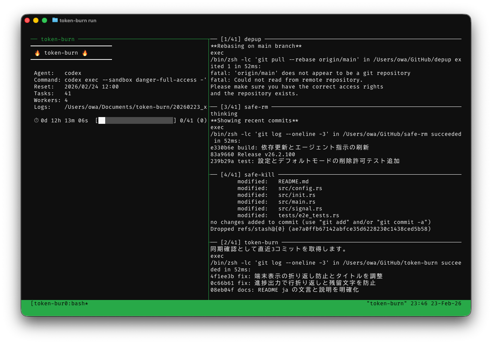
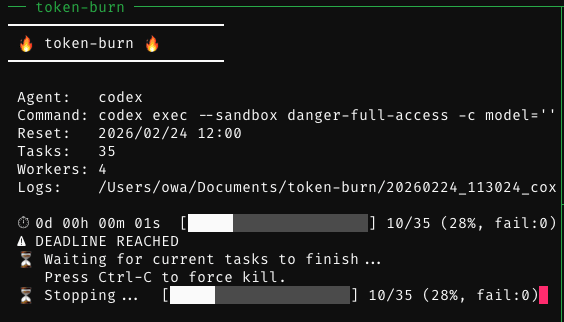

<p align="center">
  
</p>

<h1 align="center">token-burn</h1>

<p align="center">
  プロンプトを複数のリポジトリで並列に実行し、余った Claude Code / Codex CLI のトークンを週次リセットの前に使い切る CLI ツール
</p>

<!-- standard:badges:start -->
<h3 align="center">対応プラットフォーム</h3>

<p align="center">
  
</p>

<p align="center">
  <a href="https://github.com/owayo/token-burn/actions/workflows/ci.yml"></a>
  <a href="https://github.com/owayo/token-burn/releases/latest"></a>
  <a href="LICENSE"></a>
</p>

<p align="center">
  <a href="README.md">English</a> |
  <a href="README.ja.md">日本語</a>
</p>
<!-- standard:badges:end -->

---

Claude Code / Codex CLI のトークンは週次でリセットされますが、未使用分は繰り越されません。「もったいない」精神で、**token-burn** はリセット直前の残りトークンを有効活用します。コードレビュー、バグ修正、リファクタリング、テスト改善など、自由に定義したプロンプトをリポジトリ群に対して並列実行します。リセット時刻が来ると、新規タスクの開始を止め、実行中のタスクが完了するまで待機します。

<p align="center"></p>

## 機能

- **デッドラインに合わせた実行**: リセット期限が最も近いエージェントを選びます。リセット時刻が来たら新しいタスクを始めず、実行中のタスクが終わるのを待ちます
- **分割画面での並列実行**: ratatui の画面にモニターとワーカーを配置します。ペインの切替・拡大・スクロールに対応し、デタッチ後も実行が続きます。`token-burn attach` で再接続できます。ワーカーへの入力が詰まっても、停止要求と他ワーカーの操作は処理します
- **負荷とディスクの表示**: モニターのペインに、直近 5 分の CPU とメモリの使用率のグラフ、メモリの逼迫度、スワップ、ディスクの空き容量を出します。ai-usage が `--disk` に対応していれば、ディスクは Finder と同じ基準で測ります
- **リポジトリの自動探索**: 複数の `[[scan]]` 設定でディレクトリを走査して Git リポジトリを集め、remote のオーナーがユーザー名と一致するものに絞ります。同じディレクトリは 1 回だけ処理します
- **処理順**: 公開リポジトリを非公開リポジトリより前に置き、各グループの中は最終変更が古い順に並べます。最近処理したターゲットは `skip_within` の期間スキップします
- **対象選択 TUI**: `-i` / `--interactive` で対象と実行順を選び、`Tab` でワーカー数・停止閾値・ドライランも変更できます
- **設定 TUI**: `token-burn config` でエージェント、探索先、プロンプト、ai-usage 連携を編集・保存できます。項目の説明と選択肢を表示し、保存前に検証します
- **Claude Code・Codex CLI・任意のエージェント**: 無人実行に要るフラグを自動で付けます。Claude Code には stream-json 出力と `AskUserQuestion` の禁止、Codex CLI には `approval_policy=never` と `--json` です
- **ai-usage による実際のリセット時刻**: 各アカウントのリセット時刻と使用率を `ai-usage --json` から読めます (任意)。読めないときは曜日固定のスケジュールに戻ります
- **複数アカウント**: 1 つのエージェントをアカウントごと (`claude-work` / `claude-home`) に展開し、環境変数と処理済み履歴を分けて持ちます。`dedup_scope` を使うと、別のアカウントが止まった所から続けられます
- **レート制限への対応**: 週次枠が `rate_limit_threshold` に達したら恒久停止し、5 時間枠ならリセットまで一時停止します。一時停止が延長された場合も、再開前に使用率を確かめ直します。ai-usage 連携があれば、一時停止中も使用率を取り直し、手動リセットで枠が戻ればリセット時刻を待たずに再開します。月次の追加課金枠 (overage) では止まりません
- **中断セッションの再開**: レート制限で切られた Claude Code のセッションを、次の実行で `claude --resume` により続きから再開します。ラッパースクリプトがエージェントを起動する前に終了コード 75 で終わった場合は、失敗として数えずに次の実行で処理し直します。再開した実行のフッターには、その実行で使った量をセッション全体の累計と並べて出します
- **読みやすいライブモニター**: Claude Code の stream-json を読める行に整形します。思考のナレーション（思考の本文の代わりに Claude Code が見せる短い進捗の要約）を残し、API リトライ後にストリームが欠けた応答も補い、ツール呼び出し、サブエージェントの動き、タスク名付きの状態更新、権限拒否の理由、モデルの文脈に含まれない結果、フックの差し戻し、文脈圧縮、コマンドのキャンセル、トークン使用量、モデルごとのコスト、API エラーを表示します。Codex CLI の JSON イベントは、編集のたびに出し直される累積 diff の代わりに、コマンドと変更したファイルを 1 行ずつ表示し、Codex が黙っている間はハートビートを出します。Git コミットの結果には反映先のブランチも表示します。ツールの出力と結果メタデータに含まれるエスケープシーケンスは取り除くので、コマンドの出力でペインが消去されたりタイトルを書き換えられたりしません
- **状態とログの保全**: `state.json` はロックを取ってアトミックに更新し、タスクごとのログには連番を付けて上書きを防ぎます。整形器がログや表示先へ書けなくても入力を最後まで読み、タスクは失敗として記録します。Claude の整形器はレート制限の検査も続けます。分割画面が終了した後も、失敗したタスクの理由を起動元の端末に表示し、ログのディレクトリの `errors.txt` に残します。保存できない場合も警告を出し、端末への集計表示を続けます
- **ドライランと安全なコマンド表示**: `-n` / `--dry-run` で実行計画を確かめられます。実行計画と モニターのどちらも、環境変数代入と認証オプションの値は `<redacted>` に伏せます

## 動作環境

- **Claude Code** および/または **Codex CLI**: 少なくとも1つのエージェントが必要
- **gh CLI**: リポジトリ可視性の検出に必要
- **ai-usage** (任意): [ai-usage 連携](docs/configuration.ja.md#ai-usage-連携任意)を使うときだけ必要

## インストール

<!-- standard:install:start -->
### Homebrew (macOS)

```bash
brew install owayo/token-burn/token-burn
```

### Cargo

Rust 1.98 以上が必要です。

```bash
cargo install --git https://github.com/owayo/token-burn --locked
```

### GitHub Releases から

[Releases](https://github.com/owayo/token-burn/releases/latest) から自分の環境のアーカイブを取得して展開し、`token-burn` を `PATH` の通った場所に置きます。各リリースには、取得したファイルを確かめるための `SHA256SUMS` も添付しています。

| プラットフォーム | ファイル |
|---|---|
| macOS (Intel) | `token-burn-x86_64-apple-darwin.tar.gz` |
| macOS (Apple Silicon) | `token-burn-aarch64-apple-darwin.tar.gz` |

macOS でブラウザから取得した場合は、実行の前に隔離属性を外します: `xattr -d com.apple.quarantine token-burn`。

### ソースから

[mise](https://mise.jdx.dev/) が必要です (Rust のツールチェーンは `mise.toml` で固定しています)。

```bash
git clone https://github.com/owayo/token-burn.git
cd token-burn
make install
```

`make install` は `/usr/local/bin` に入れます。場所を変えるときは `INSTALL_PATH` を指定します (例: `make install INSTALL_PATH="$HOME/.local/bin"`)。
<!-- standard:install:end -->

## クイックスタート

設定画面を開きます。設定ファイルが無ければ新規作成、あれば既存の設定を編集します。

```bash
token-burn config
```

エージェントのコマンドとリセット日時、探索先を設定し、`s` で変更を確認して保存します。新規作成時のリセット日時は仮の月曜 09:00 UTC なので、実際の予定に変更してください。初めて実行する前に、リセット時刻と実行計画を確かめます。

```bash
token-burn status
token-burn run -n
```

TOML を直接編集する場合は、`token-burn init` で設定とプロンプトファイルの雛形を生成できます。設定画面の操作は [設定 TUI](docs/configuration.ja.md#設定-tui) を参照してください。

## 使い方

```bash
# トークン消費を実行する (最大 `limit` 件のターゲット)
token-burn run

# 先に TUI で対象と実行順を選ぶ
token-burn run -i

# デタッチした実行へ再接続する
token-burn attach

# 特定のリポジトリだけを実行する (スキャンとスキップの規則を使わない)
token-burn run ~/GitHub/repo-a ./repo-b

# 何も実行せずに、全ターゲットを処理する順に一覧する
token-burn list

# 3 日より古いレポートディレクトリを削除する
token-burn clean --older-than 3d
```

リセット時刻が来ると、token-burn は新しいタスクの開始を止め、実行中のタスクが終わるまで待ちます。

<p align="center"></p>

詳しい説明:

- [CLI リファレンス](docs/cli-reference.ja.md): すべてのコマンドとオプション
- [使い方の詳細](docs/usage.ja.md): 処理順、中断セッションの再開、分割画面での実行、ログと状態
- [レート制限](docs/rate-limits.ja.md): 実行が止まる場合と、一時停止で済む場合
- [ライブモニター](docs/monitor.ja.md): ワーカーとモニターのペインに出る内容

## 設定

設定ファイルの既定の場所は `~/.config/token-burn/config.toml` です (別のファイルを使うときは `-c` / `--config` を渡します)。`state.json` (処理済みのターゲット) と `resume.json` (中断したセッション) も同じディレクトリに置かれます。

エージェント 1 つとスキャン設定 1 つだけの最小の設定:

```toml
[settings]
parallelism = 3
skip_within = "1d"
limit = 10

[prompts]
default = "prompts/default.md"

[[agents]]
name = "claude"
command = ["claude", "--dangerously-skip-permissions", "--model", "opus"]
reset_weekday = "monday"
reset_time = "09:00"
timezone = "Asia/Tokyo"

[[scan]]
base_dirs = ["~/GitHub"]
username = "yourname"
```

`.md` で終わるプロンプトの値は、設定ファイルのディレクトリからの相対パスとして読み込みます。**プロンプト優先順位**: `[[targets]].prompt` > `[[agents]].prompt` > `[prompts].default`

すべてのセクション (`[settings]`、`[[agents]]`、実際のリセット時刻と複数アカウントのための `[ai_usage]`、`[[scan]]`、`[prompts]`、`[[targets]]`) は [docs/configuration.ja.md](docs/configuration.ja.md) で説明しています。

## 開発

<!-- standard:dev:start -->
[mise](https://mise.jdx.dev/) が必要です。ツールの版は `mise.toml` で固定しています。

```bash
make setup   # ツールチェーン (mise) と依存を取得する
make ci      # CI と同じ検査 (書き換えない)
```

| コマンド | 説明 |
|---|---|
| `make setup` | ツールチェーン (mise) と依存を取得する |
| `make build` | デバッグ版をビルドする |
| `make release` | リリース版をビルドする |
| `make run` | デバッグ版を実行する (引数は ARGS="...") |
| `make test` | テストを実行する |
| `make lint` | clippy を警告ゼロで通す |
| `make fmt` | コードを整形する (書き換える) |
| `make fmt-check` | 整形済みかを確かめる (書き換えない) |
| `make check` | 整形と静的検査 (書き換えない) |
| `make ci` | CI と同じ検査 (書き換えない) |
| `make install` | リリース版を INSTALL_PATH (既定 /usr/local/bin) に入れる |
| `make uninstall` | INSTALL_PATH から取り除く |
| `make clean` | ビルド成果物を消す |

`make` でターゲットの一覧を表示します。リリースは GitHub Actions で行います (**Actions → Release → Run workflow**)。
<!-- standard:dev:end -->

## ライセンス

<!-- standard:license:start -->
[MIT](LICENSE)
<!-- standard:license:end -->
