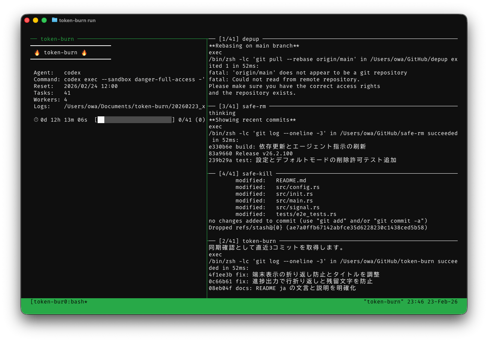
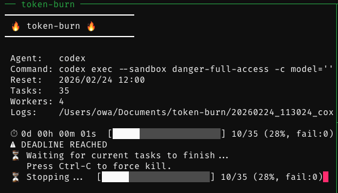

<p align="center">
  
</p>

<h1 align="center">token-burn</h1>

<p align="center">
  CLI tool that spends leftover Claude Code and Codex CLI tokens before the weekly reset by running your prompts across your repositories in parallel
</p>

<!-- standard:badges:start -->
<h3 align="center">Supported Platforms</h3>

<p align="center">
  
  
</p>

<p align="center">
  <a href="https://github.com/owayo/token-burn/actions/workflows/ci.yml"></a>
  <a href="https://github.com/owayo/token-burn/releases/latest"></a>
  <a href="LICENSE"></a>
</p>

<p align="center">
  <a href="README.md">English</a> |
  <a href="README.ja.md">日本語</a>
</p>
<!-- standard:badges:end -->

---

token-burn runs your prompts across repositories in parallel to use remaining Claude Code and Codex CLI capacity before the reset. Code reviews, bug fixes, refactoring, and test improvements turn leftover tokens into work, in the Japanese spirit of *mottainai* (もったいない). At the deadline, token-burn stops starting new tasks and waits for running tasks to finish.

Connect [ai-usage](https://github.com/owayo/ai-usage) to automatically obtain each account's actual reset time and utilization. token-burn uses those reset times to choose the next agent and set its execution deadline. Fixed weekday/time schedules are also supported.

<p align="center"></p>

## Features

- Automatically manage reset deadlines with ai-usage, using weekly, five-hour, or the nearest reset window. Choose a fixed-schedule fallback, skip the affected agent, or stop if reset data is unavailable.
- Run Claude Code, Codex CLI, or a custom agent in parallel. Claude and Codex receive the flags needed for unattended execution and readable output.
- Watch a native split-screen TUI with target paths in worker titles, model and effort values when available, account utilization, CPU and memory graphs, swap activity, and free disk space.
- Add a directory to the running queue with `a`. Detach with `d` and reconnect with `token-burn attach`; execution continues while the screen is closed.
- Choose targets and execution order with `run -i`. Change workers, the stop threshold, and dry-run mode before confirming the run.
- Edit agents, prompts, scan sources, and ai-usage integration with `token-burn config`, including validation before saving.
- Discover Git repositories across scan directories, process the least-recently-modified first, and skip recently processed targets. Public-first ordering is configurable.
- Use multiple accounts with separate environments and history. `dedup_scope` can share processed-target history across accounts or providers.
- Stop further tasks at a long-window usage limit, or pause until a short window resets. With ai-usage integration, confirmed recovery after a manual reset can resume the run early. Interrupted Claude Code sessions can continue on the next run.
- Follow formatted Claude and Codex events, including tool calls, subagent activity, token usage, costs, and errors. Keep per-task logs and collect task failure reasons in `errors.txt`. Dry-run plans and monitor command displays redact environment assignments and credential options.

## Requirements

- On Windows: Windows 10 version 1809 or later, or Windows 11 (x64), and [Git for Windows](https://gitforwindows.org/). Run from Windows Terminal or PowerShell. See [Windows setup](docs/windows.md) for Bash detection and path settings.
- The CLI for at least one agent, such as Claude Code or Codex CLI.
- `gh` CLI for GitHub repository lookup and visibility detection when a scan uses `username`.
- [ai-usage](https://github.com/owayo/ai-usage) for automatic reset times and usage checks. It is optional when using a fixed schedule.

## Installation

<!-- standard:install:start -->
### Homebrew (macOS)

```bash
brew install owayo/token-burn/token-burn
```

### Cargo

Requires Rust 1.99 or later.

```bash
cargo install --git https://github.com/owayo/token-burn --locked
```

### From GitHub Releases

Download the archive for your platform from [Releases](https://github.com/owayo/token-burn/releases/latest), extract it, and put `token-burn` on your `PATH`. Each release also includes `SHA256SUMS` for checking the downloads.

| Platform | Archive |
|---|---|
| macOS (Intel) | `token-burn-x86_64-apple-darwin.tar.gz` |
| macOS (Apple Silicon) | `token-burn-aarch64-apple-darwin.tar.gz` |
| Windows (x86_64) | `token-burn-x86_64-pc-windows-msvc.zip` |

On macOS, if you downloaded the archive with a browser, remove the quarantine attribute before running it: `xattr -d com.apple.quarantine token-burn`.

### From Source

Requires [mise](https://mise.jdx.dev/) (the Rust toolchain is pinned in `mise.toml`).

```bash
git clone https://github.com/owayo/token-burn.git
cd token-burn
make install
```

`make install` installs to `/usr/local/bin`. Set `INSTALL_PATH` to change it (for example `make install INSTALL_PATH="$HOME/.local/bin"`).
<!-- standard:install:end -->

## Quickstart

Open the settings editor. It creates a new configuration if none exists, or edits the existing file:

```bash
token-burn config
```

Configure agent commands and scan directories, then choose [ai-usage integration](#automatic-reset-times-with-ai-usage) or a fixed reset schedule. Press `s` to review and save. If you use a fixed schedule, replace the starter placeholder (Monday at 09:00 UTC) with the correct day, time, and timezone. Check the reset times and their source, then preview the plan before the first run:

```bash
token-burn status
token-burn run -n
```

To edit TOML directly, use `token-burn init` to generate configuration and prompt templates. See [Settings TUI](docs/configuration.md#settings-tui) for editor controls.

## Usage

```bash
# Run token consumption (up to `limit` targets)
token-burn run

# Choose the targets and their order in a TUI first
token-burn run -i

# Reattach to a detached run
token-burn attach

# Run only specific repositories (scan and skip rules are bypassed)
token-burn run ~/GitHub/repo-a ./repo-b

# List every target in processing order without running anything
token-burn list

# Remove report directories older than three days
token-burn clean --older-than 3d
```

The execution screen has these controls in navigation mode:

| Key | Action |
|---|---|
| `Tab` / `Shift-Tab` | Select a pane |
| `z` | Zoom or restore the selected pane |
| `a` | Add a directory; Enter submits, Esc cancels |
| `PageUp` / `PageDown` | Scroll worker output |
| `i` / `Ctrl-G` | Enter / leave worker input mode |
| `d` / `q` | Detach while execution continues |
| `Ctrl-C` | Stop new tasks and wait for running ones; press again to force termination |

Worker titles include the target path. The monitor shows model and effort values when available, account utilization with ai-usage integration, and machine load. See [native split-screen execution](docs/usage.md#native-split-screen-execution) for target additions and input controls.

When the reset time arrives, token-burn stops starting new tasks and waits for the running ones to finish:

<p align="center"></p>

More detail:

- [CLI reference](docs/cli-reference.md): every command and option
- [Usage details](docs/usage.md): processing order, resuming interrupted sessions, the native runtime, logs and state
- [Rate limits](docs/rate-limits.md): when a run stops and when it only pauses
- [Live monitor](docs/monitor.md): what the worker and monitor panes show

## Configuration

Default config location: `~/.config/token-burn/config.toml` (pass `-c` / `--config` to use another file). `state.json` (processed targets) and `resume.json` (interrupted sessions) are kept in the same directory.

### Automatic reset times with ai-usage

First run `ai-usage --json` and find the account you want to use. Set `profile` below to that account's exact `profile` value; names are case-sensitive. This example obtains the weekly reset time from ai-usage, so `reset_weekday`, `reset_time`, and `timezone` are not needed.

```toml
[settings]
parallelism = 3
skip_within = "1d"
limit = 10

[prompts]
default = "Review this repository and improve its tests."

[ai_usage]
enabled = true
window = "weekly"
fallback = "error"

[[ai_usage.profiles]]
name = "work"
profile = "Work"

[[agents]]
name = "claude"
provider = "claude"
command = ["claude", "--dangerously-skip-permissions", "--model", "opus"]
[agents.ai_usage]
profiles = ["work"]

[[scan]]
base_dirs = ["~/GitHub"]
```

`name = "work"` is the reference used by `profiles = ["work"]`; `profile = "Work"` identifies the account in ai-usage. Match the agent's CLI login to that account. When switching CLI accounts, use the profile's `env` to set `CLAUDE_CONFIG_DIR` or `CODEX_HOME` as needed.

`status` and `run` show the resolved reset time and its source. Here, `fallback = "error"` stops with an error if the reset time cannot be obtained. For a fixed-schedule fallback, set `fallback = "fixed"` and add `reset_weekday`, `reset_time`, and `timezone` to the same agent. Use `fallback = "skip"` to exclude the affected agent instead. See [ai-usage integration](docs/configuration.md#ai-usage-integration-optional) for multiple profiles, account environments, and window selection.

### Fixed reset schedules

To use the example without ai-usage, remove `[ai_usage]`, `[[ai_usage.profiles]]`, and `[agents.ai_usage]`, then replace its agent definition with:

```toml
[[agents]]
name = "claude"
command = ["claude", "--dangerously-skip-permissions", "--model", "opus"]
reset_weekday = "monday"
reset_time = "09:00"
timezone = "Asia/Tokyo"
```

Prompt values ending with `.md` load a Markdown file; relative paths are resolved from the config directory. Prompt priority is `[[targets]].prompt` > `[[agents]].prompt` > `[prompts].default`.

All sections and options are described in [docs/configuration.md](docs/configuration.md).

## Development

<!-- standard:dev:start -->
Requires [mise](https://mise.jdx.dev/). Tool versions are pinned in `mise.toml`.

```bash
make setup   # Install the toolchain (mise) and dependencies
make ci      # Run the same checks as CI (no changes)
```

| Command | Description |
|---|---|
| `make setup` | Install the toolchain (mise) and dependencies |
| `make build` | Build a debug binary |
| `make release` | Build a release binary |
| `make run` | Run the debug binary (arguments via ARGS="...") |
| `make test` | Run the tests |
| `make lint` | Run clippy with warnings as errors |
| `make fmt` | Format the code (rewrites files) |
| `make fmt-check` | Check the formatting (no changes) |
| `make check` | Run fmt-check and lint (no changes) |
| `make ci` | Run the same checks as CI (no changes) |
| `make install` | Install the release binary to INSTALL_PATH (default /usr/local/bin) |
| `make uninstall` | Remove the binary from INSTALL_PATH |
| `make clean` | Remove build artifacts |

Run `make` to list every target. Releases are published from GitHub Actions (**Actions → Release → Run workflow**).
<!-- standard:dev:end -->

## License

<!-- standard:license:start -->
[MIT](LICENSE)
<!-- standard:license:end -->
